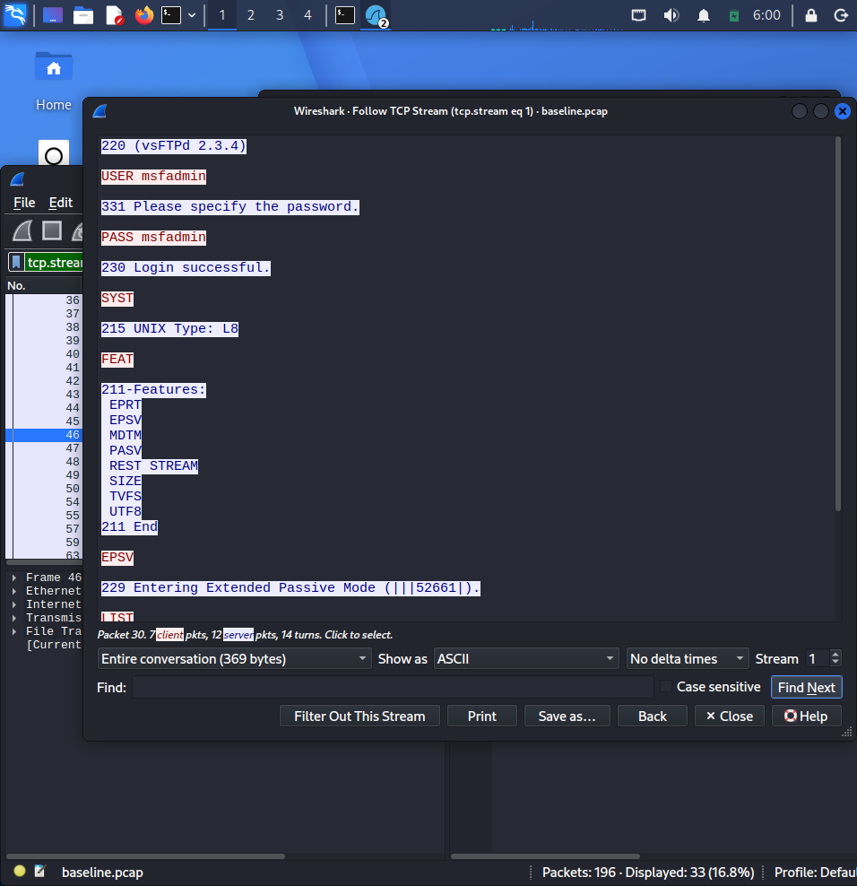

# Report 01: Baseline Traffic and Cleartext Credentials

## Objective
Capture normal traffic between Kali (192.168.100.128) and Metasploitable 2 (192.168.100.129) and identify insecure protocols.

## What I did
Captured on eth1 with tcpdump while running ping, curl (HTTP), FTP and Telnet against the target.

## Evidence
- Filter `icmp`: 3 echo requests and 3 replies
- Filter `http`: web request and response
- Filter `ftp`, then Follow > TCP Stream: `USER msfadmin` and `PASS msfadmin` visible in plaintext

## Finding
FTP and Telnet send credentials unencrypted, so anyone who can capture the traffic can read them.

## Recommendation
Replace FTP with SFTP and Telnet with SSH.

## MITRE ATT&CK
T1040 (Network Sniffing), T1552 (Unsecured Credentials)
